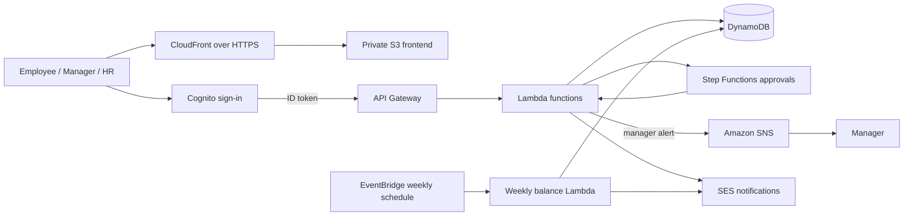
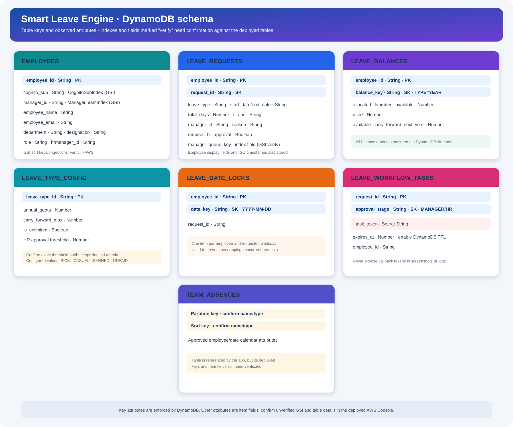
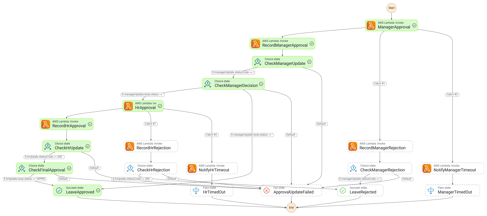
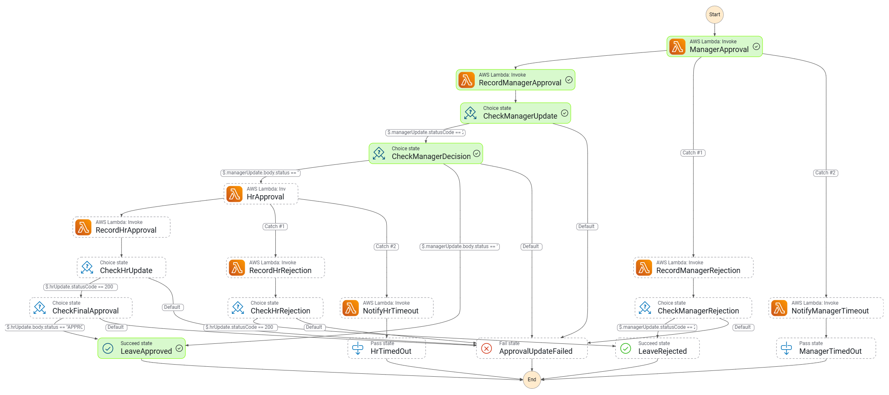
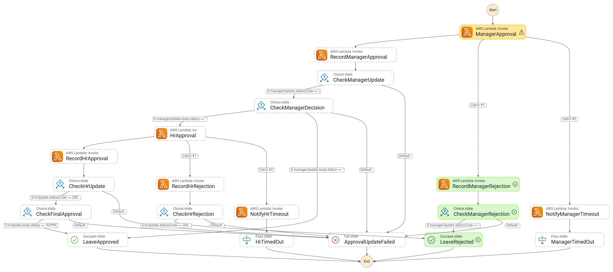
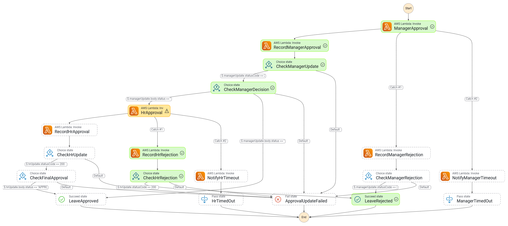
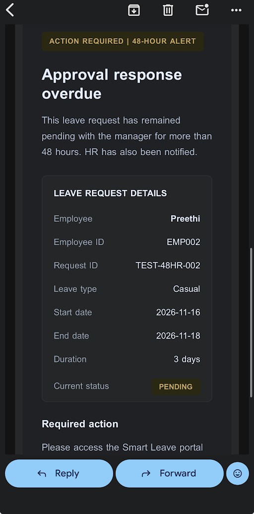
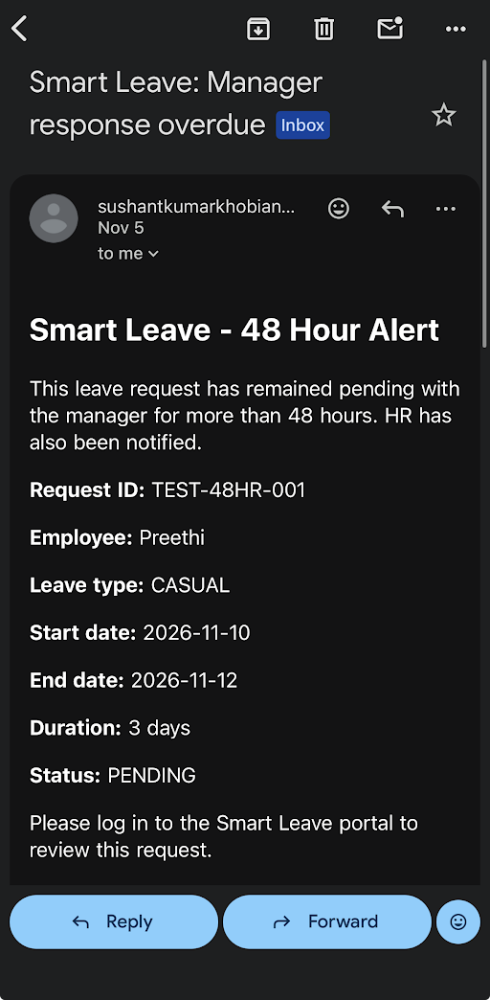
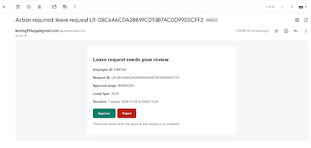

<div align="center">


### A full-cycle leave management project built with a colorful, cloud-first experience

<a href="https://d2a9x7dvtwdsno.cloudfront.net"></a>


<br />


</div>

## Project overview

Smart Leave Engine brings employees, managers, and HR into one leave-management workflow. Employees can review balances, submit leave, and track requests. Managers and HR review requests, while approved absences feed the team calendar and downloadable report.

The React frontend is hosted privately in Amazon S3 and served over HTTPS through CloudFront. Cognito provides sign-in, and the frontend sends Cognito ID tokens to API Gateway routes for backend data and actions.

## What the project demonstrates

| Area | Project skills demonstrated |
| --- | --- |
| Frontend | React UI, reusable components, responsive dashboards, form validation, status displays, CSV export |
| Identity and security | Cognito sign-in and password challenges; bearer ID-token requests; API Gateway JWT authorization |
| Serverless data | API Gateway and Lambda integration with DynamoDB leave requests, employee balances, and configuration |
| Workflow automation | Step Functions manager/HR approval stages and timeout handling |
| Notifications and scheduling | SNS manager alerts, SES email notifications, and EventBridge weekly balance-summary job |
| Static web delivery | Production build, private S3 origin, CloudFront Origin Access Control, HTTPS and cache invalidation |

## Technology showcase

<p>
  
  
  
  
  
  
  
  
  
  
  
</p>

## Architecture



## DynamoDB schema overview



See the [DynamoDB schema documentation](docs/dynamodb-schema.md) for key attributes, table details, and quota rules.

## Workflow outcome screenshots

These AWS Step Functions execution graphs document four workflow outcomes from the project: manager approval followed by HR approval, manager approval, manager rejection, and HR-stage rejection.

### Manager approval followed by HR approval



### Manager approval



### Manager rejection



### HR-stage rejection



## Step Functions definition

The current Amazon States Language (ASL) definition is available at [`docs/workflows/SmartLeaveEngineStateMachine.asl.json`](docs/workflows/SmartLeaveEngineStateMachine.asl.json). It includes manager and HR approval, rejection recording, timeout notifications, and final workflow outcomes. The Lambda ARNs in this snapshot point to the project AWS account; update them for another account before deploying.

## Notification screenshots

These examples show SES email notifications: the 48-hour manager-inactivity alert sent to HR and the manager approval email. The alert screenshots contain test employee names and request IDs. Amazon SNS is included in the architecture for manager alerts; a separate SNS delivery screenshot was not supplied.

<details>
  <summary>48-hour alert details</summary>
  
</details>

<details>
  <summary>48-hour alert email</summary>
  
</details>

<details>
  <summary>Manager approval email with approve and reject actions</summary>
  
</details>

Do not upload passwords, Cognito tokens, or signed approval-link tokens. The two browser screenshots containing signed tokens are intentionally excluded.

The employee submission and post-approval employee confirmation email still need screenshots to complete the end-to-end evidence set.

## Current integration status

- Cognito sign-in and the employee, manager, and HR API dashboard routes are integrated in the frontend.
- Leave submission and approval actions call authenticated API Gateway routes.
- The weekly EventBridge Lambda has successfully run and sent a balance-summary email.
- The workflow screenshots include completed manager approval, manager-plus-HR approval, manager rejection, and HR-stage rejection paths. If an approval returns HTTP 409, inspect the employee balance record: `available` and `used` must be DynamoDB Numbers, not Strings.
- The backend and SAM infrastructure are maintained separately from this frontend repository by the infrastructure owner.

This is a team project in active integration. Confirm the deployed routes, table names, IAM policies, and workflow definition against the team’s current SAM stack before using the portal with real employees.

## Run locally on Windows

Requirements: Node.js and npm.

1. Clone this repository and open PowerShell in its folder.
2. Copy the sample configuration:

   ```powershell
   Copy-Item .env.example .env.local
   ```

3. Install packages and start the development server:

   ```powershell
   npm.cmd install
   npm.cmd start
   ```

4. Open `http://localhost:3000`.

The Cognito IDs and API URL are public client configuration values. Never put passwords, AWS access keys, HMAC secrets, Cognito tokens, or private employee data in `.env.local` or GitHub. `.env.local` is ignored by Git.

## Build and deploy the frontend

Run a production build:

```powershell
npm.cmd run build
```

Upload the **contents** of `build/` to the root of the private S3 bucket. Keep S3 Block Public Access enabled, use CloudFront Origin Access Control, set the default root object to `index.html`, require HTTPS, then invalidate `/*` after uploading.

## Repository map

```text
smart-leave-absence-management-engine/
├── cloudfront-s3/       # S3/CloudFront policy template
├── docs/
│   ├── assets/          # README artwork
│   ├── screenshots/     # Verified project outcome screenshots
│   ├── schema/          # Separate entity-and-attributes diagram per table
│   ├── workflows/       # Step Functions ASL definition
│   └── dynamodb-schema.md # Table keys, indexes, and leave-balance rules
├── public/
├── src/
│   ├── components/      # Employee and shared UI components
│   ├── config/          # Cognito and API configuration
│   ├── services/        # Cognito authentication and API requests
│   ├── App.js
│   └── index.js
├── .env.example
└── README.md
```

See the [DynamoDB schema and quota rules](docs/dynamodb-schema.md) for the table keys, observed indexes, item attributes, and the fields that still need confirmation against the deployed tables.

## Team

| Team member | Area |
| --- | --- |
| Sushant | DynamoDB schema and leave data logic |
| Omsri | Approval workflow and messaging |
| Payal | SAM infrastructure, security, and scheduled jobs |
| Preethi | Frontend, dashboards, and static hosting |
