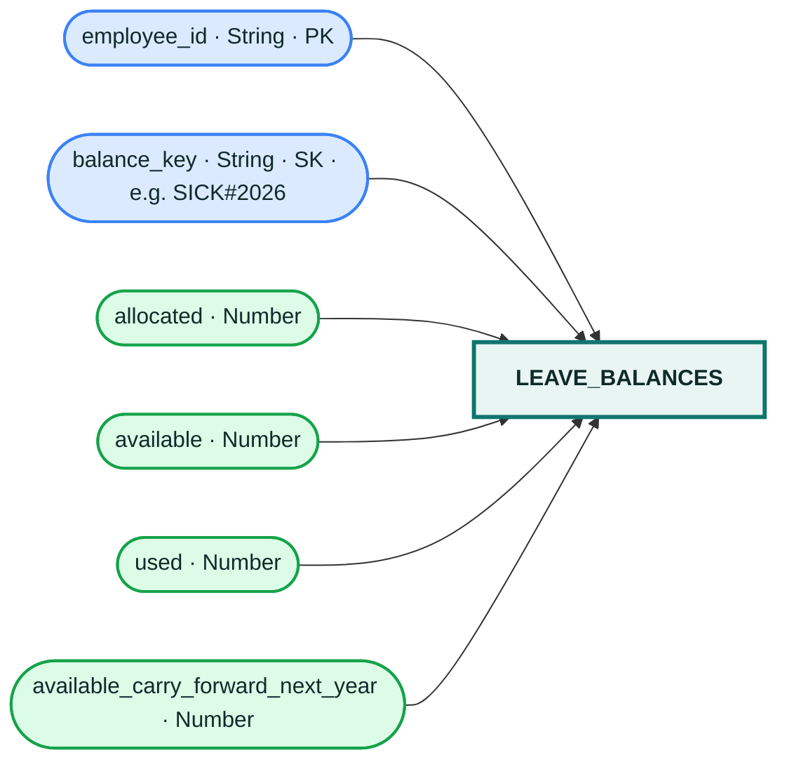

# `leave_balances` table

Store every balance field as a DynamoDB Number. Pending requests do not consume balance; charge paid leave only after final approval. `UNPAID`/loss-of-pay requests should not decrement paid leave balances.
