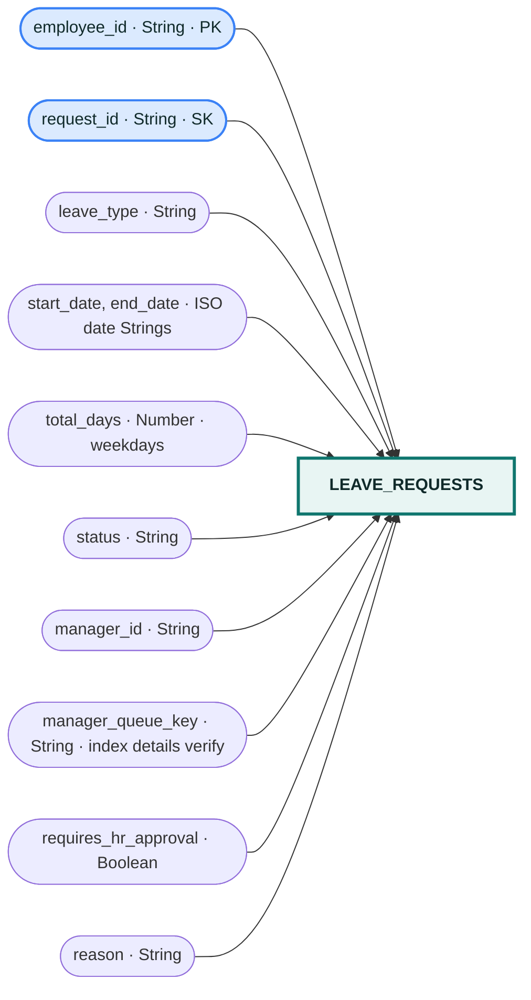

# `leave_requests` table

The main table keys are `employee_id` and `request_id`. `manager_queue_key` is present on request items; verify the deployed GSI name and key schema before documenting it as an index.
