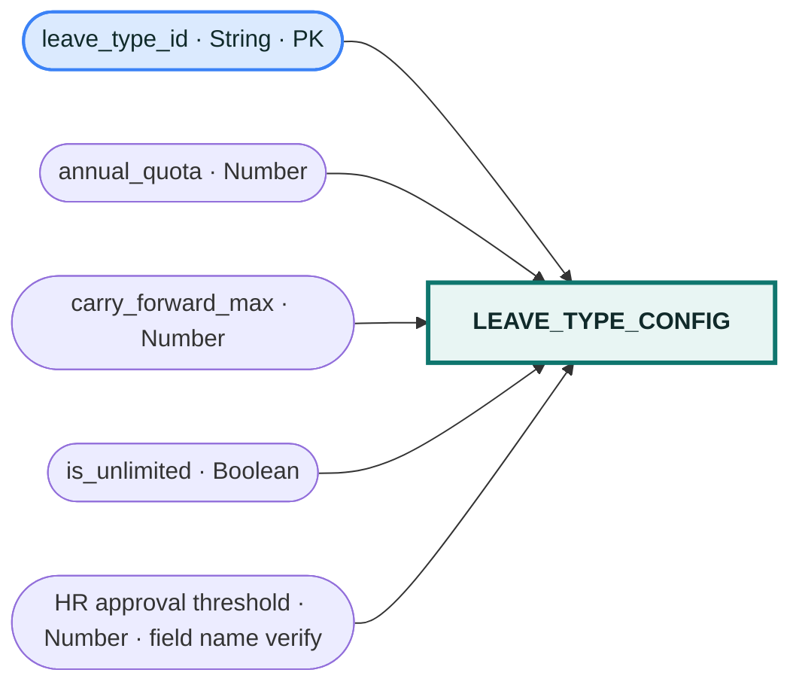

# `leave_type_config` table

Configured leave types shown in the console: `SICK`, `CASUAL`, `EARNED`, and `UNPAID`. Confirm the exact HR-threshold attribute name against the Lambda code; the console screenshot showed the start of its name but not the full label.
