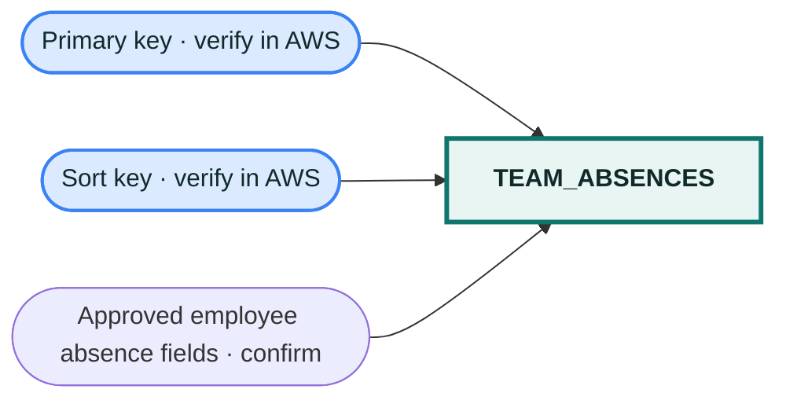

# `team_absences` table

The table name appears in backend configuration, but its keys and item attributes were not visible in the available Console screenshots. Fill this diagram from DynamoDB → Tables → `team_absences` → **General information** and **Indexes** before treating it as final.
